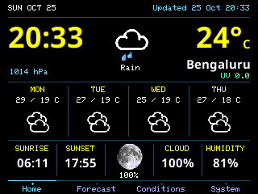
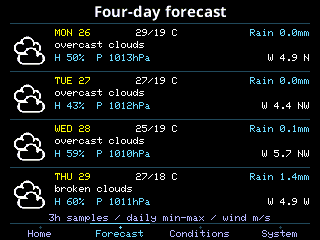
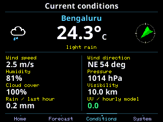
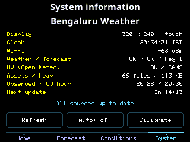

# Bengaluru CYD Weather Station — v3.1

A 320×240 landscape weather station for an ESP32-WROOM-32 CYD with an
ILI9341 display, XPT2046 resistive touch, and 4 MB flash.






The four touch pages show current weather, four forecast days, conditions, and
system information. Home includes a large moon icon with only its illumination
percentage underneath. The clock, sunrise/sunset, and forecast days use Bengaluru
IST (UTC+05:30). UV is the current hourly Open-Meteo/CAMS model value.

## Start here

Read [START_HERE.md](START_HERE.md) for the short setup and GitHub-upload checklist.
All project-specific downloads are in this repository: the four configured library
ZIPs, the LittleFS uploader VSIX, source, and 66 runtime assets. Arduino IDE and the
Espressif ESP32 3.2.0 board package are separate platform prerequisites installed
once. A first-time setup therefore still needs those platform downloads.

## Arduino IDE setup

### 1. Install the ESP32 board package

Use Arduino IDE 2.2.1 or newer. In Preferences, add this Boards Manager URL:

```
https://espressif.github.io/arduino-esp32/package_esp32_index.json
```

In Boards Manager, install **esp32 by Espressif Systems, version 3.2.0**.
See the [official ESP32 installation guide](https://docs.espressif.com/projects/arduino-esp32/en/latest/installing.html).

### 2. Install the four bundled libraries

For each ZIP in `libraries/`, choose **Sketch → Include Library → Add .ZIP Library**:

| Library | Bundled version |
| --- | --- |
| TFT_eSPI, already configured for the CYD ILI9341 | 2.5.44 |
| TJpg_Decoder | 1.1.0 |
| ArduinoJson | 7.4.2 |
| XPT2046_Touchscreen | 1.4 |

These ZIPs contain the exact tested library runtime sources and their licensing
notices. Optional upstream examples and documentation were omitted to reduce size.
Sources and SHA-256 hashes are recorded in `libraries/manifest.json`.

The bundled TFT_eSPI `User_Setup.h` already matches
`Setup801_ESP32_CYD_ILI9341_240x320.h`. If another TFT_eSPI installation exists,
use the bundled one, or replace that installation's `User_Setup.h` with this
setup file. Keep the default `#include <User_Setup.h>` selected in
`User_Setup_Select.h`. Reapply this configuration after updating TFT_eSPI.
The alternative ST7789 setup is included as a reference; the hardware verified
for this release uses ILI9341.

### 3. Open the complete sketch folder

Open this file in Arduino IDE:

```
Esp32_CYD_TFT_eSPI_OpenWeather_LittleFS_v02/
  Esp32_CYD_TFT_eSPI_OpenWeather_LittleFS_v02.ino
```

Keep every `.h`, `.cpp`, `.ino`, and the `data/` directory together in that folder.
Arduino IDE automatically compiles its supporting source files.

### 4. Enter your own Wi-Fi and API credentials

Copy `Secrets.example.h` to **`Secrets.h` in the same sketch folder**. Edit only
that private copy to enter your 2.4 GHz Wi-Fi name/password and an activated
OpenWeather API key. The second API key is optional. `Secrets.h` is ignored by
Git; the included example contains placeholders and supports compile-only checks.

Location, timezone, intervals, and hardware pins are in `All_Settings.h`.
The default location is Bengaluru: 12.9719 N, 77.5937 E.

### 5. Select these Tools settings

| Setting | Value |
| --- | --- |
| Board | ESP32 Dev Module |
| CPU Frequency | 240 MHz |
| Flash Size | 4MB (32Mb) |
| Flash Mode | DIO |
| Flash Frequency | 40 MHz |
| Partition Scheme | No OTA (2MB APP/2MB SPIFFS) |
| PSRAM | Disabled |
| Upload Speed | 115200 |
| Erase All Flash Before Sketch Upload | Disabled |
| Port | Your connected CYD serial port |

The partition menu uses the name SPIFFS; this firmware mounts that data partition
as LittleFS. The filesystem size is 1,966,080 bytes, starting at `0x210000`.

### 6. Upload both the sketch and the filesystem

1. Click **Verify**, then **Upload** in Arduino IDE.
2. Install the bundled `tools/littlefs-uploader/arduino-littlefs-upload-1.6.3.vsix`.
   Copy it into `~/.arduinoIDE/plugins/` on Linux/macOS, or
   `C:\Users\<username>\.arduinoIDE\plugins\` on Windows, then restart the IDE.
   See `tools/littlefs-uploader/INSTALL.txt`. This is the unmodified official
   [LittleFS uploader](https://github.com/earlephilhower/arduino-littlefs-upload).
3. Close Serial Monitor. Keep the same board, partition scheme, port, and sketch
   selected. Open the command palette with **Ctrl+Shift+P** (macOS: Cmd+Shift+P)
   and run **Upload LittleFS to Pico/ESP8266/ESP32**.
4. Reset the board. It uploads the sketch's `data/` folder: all 66 fonts, moon,
   wind, weather, and splash assets are included in this repository.

Serial Monitor at **115200 baud** reports startup, asset checks, update results,
and touch calibration. The System page also shows API/network status.

## Touch controls

- Tap the footer labels to open Home, Forecast, Conditions, or System.
- Swipe left/right to change pages; a tap on the left/right body goes back/forward.
- Hold any page for two seconds, or use System → Calibrate, then hold and release
  each of four targets. Calibration persists in NVS.
- System → Auto enables cycling every 6.5 seconds; the choice survives reboot.
- System → Refresh requests a weather update. Repeat requests while busy are
  ignored. The System countdown shows the next update or retry.

The TFT uses HSPI: MOSI 13, MISO 12, CLK 14, CS 15, DC 2, backlight 21.
Touch uses its own VSPI bus: MOSI 32, MISO 39, CLK 25, CS 33. IRQ 36 is configured
as input; pressure is polled. Both display and touch use landscape rotation 1.

## Weather data and behavior

- Current observations: OpenWeather `/data/2.5/weather`.
- Forecast: OpenWeather `/data/2.5/forecast`. Each of the next four IST calendar
  days aggregates its available 3-hour samples for min/max and rain total.
  Description, pressure, humidity, and wind use the sample nearest local noon.
- UV: Open-Meteo air-quality endpoint, `hourly=uv_index&timeformat=unixtime`.
  The selected sample contains the current UTC hour. UV can be zero at night.
- Refresh: every 15 minutes; retry after 60 seconds on failure. Valid old data is
  retained, missing values show dashes, and old observations are marked stale.
- HTTPS verifies certificates using the included public trust anchors. Time
  synchronization must succeed before HTTPS requests run.

## Optional command-line build and tests

Install [Arduino CLI](https://docs.arduino.cc/arduino-cli/installation/) and the
same ESP32 3.2.0 board core. Then, from the repository root:

```sh
arduino-cli core update-index --additional-urls https://espressif.github.io/arduino-esp32/package_esp32_index.json
arduino-cli core install esp32:esp32@3.2.0 --additional-urls https://espressif.github.io/arduino-esp32/package_esp32_index.json
python3 tools/build.py
python3 tools/test.py
```

Python 3.9+ is used for these optional helpers; host tests also need `g++` and a
C library providing `strlcpy` (verified on this Linux workstation). `build.py`
checks library hashes, extracts the bundled sources, and compiles with the same
board settings listed above. Generated files stay under `.build/`.

## Source organization and publishing

- `DisplayUI.*`: page layouts, bitmap rendering, splash, asset checks.
- `WeatherNetwork.*`: background HTTPS updates, retry timing, API-key fallback.
- `WeatherJson.*`, `WeatherModel.*`: JSON validation, forecasts, gestures/calibration.
- `NTP_Time.h`, `MoonPhase.ino`: IST formatting and lunar calculations.
- `All_Settings.h`, `Secrets.example.h`: public settings and credential template.
- `data/`: all 66 runtime asset files.

Screenshot servers, framebuffer capture, unused GfxUi files, and serial bench
commands have been removed from the production firmware. The images above are
captures from the previous verified UI build with the same page layout.

Publish the contents of this repository folder, including `data/`, `libraries/`,
`LICENSE`, and `.gitignore`. Each builder creates their own private `Secrets.h`.
No compiled firmware, personal credentials, machine-specific paths, or old private
build backups are included in the release archive.

## Credits and license

This project adapts Michael Fehr's
[ESP32 CYD Weather Station with Forecast](https://github.com/AndroidCrypto/ESP32_CYD_Weather_Station_With_Forecast),
Bodmer's TFT/LittleFS graphics work, and ThingPulse/Daniel Eichhorn's
[color weather station](https://github.com/ThingPulse/esp8266-weather-station-color).
The landscape geometry follows the supplied HTML reference.

See `LICENSE`, `THIRD_PARTY_NOTICES.txt`, and the bundled libraries' original
licensing notices. API data and services retain their providers' terms.


## Blank screen after a manual Arduino IDE upload

Library Manager's stock TFT_eSPI setup uses generic wiring. Replace the installed
TFT_eSPI library's `User_Setup.h` with the supplied Setup801 CYD file, or install
the bundled configured TFT_eSPI ZIP. A library update can overwrite that setting.
This release now checks the selected TFT setup at compile time.

In Tools, select **No OTA (2MB APP/2MB SPIFFS)**, **DIO**, **40 MHz**, and **4 MB**.
Changing the partition layout requires uploading both the sketch and `data/`
again. The firmware now refuses to compile with the default partition scheme.
If Serial Monitor reports `FATAL: LittleFS mount failed`, verify this setting and
upload the full LittleFS data directory with the same board/partition selection.
Create your private `Secrets.h` for Wi-Fi and API access; keep the example generic.
